<picture>
  <source media="(prefers-color-scheme: dark)" srcset="./ascii-portrait-dark.svg">
  <source media="(prefers-color-scheme: light)" srcset="./ascii-portrait-light.svg">
  
</picture>
<!--
Raksha Kiran — GitHub Profile README
Place this README.md, dark.svg, and light.svg in the repository named exactly:
Raksha23zz
-->

<picture>
  <source media="(prefers-color-scheme: dark)" srcset="./dark.svg">
  <source media="(prefers-color-scheme: light)" srcset="./light.svg">
  
</picture>

<h2 align="center">Hi, I'm Raksha Kiran 👋</h2>

  Aspiring Full Stack Developer

  I enjoy learning and building with web technologies, programming languages, and databases.

---

### About Me

- 🎓 BE student at **St Joseph Engineering College**
- 💻 Exploring full-stack development
- 🧩 Interested in building practical software projects
- 📫 Reach me at **[raksha6556@gmail.com](mailto:raksha6556@gmail.com)**

### Tech Stack

**Languages:** C++, JavaScript, Python

**Web:** HTML, CSS, React

**Databases:** MongoDB, SQL

### Featured Projects

- **Admission Token Queue Management System**
- **Smart Parking System**
- **CampusFix**
- **sbom_analyzer_risk_detector**

### Education

- **BE** — St Joseph Engineering College
- **Pre-University** — Sharada PU College
- **Schooling** — Mount Carmel Central School

### Certifications

- Introduction to Selenium
- Data Analyst: Power BI
- API
- Data Structures

### Connect With Me

  <a href="https://github.com/Raksha23zz">GitHub</a>
  &nbsp;·&nbsp;
  <a href="https://www.linkedin.com/in/raksha-k-abb087326/">LinkedIn</a>
  &nbsp;·&nbsp;
  <a href="mailto:raksha6556@gmail.com">Email</a>

